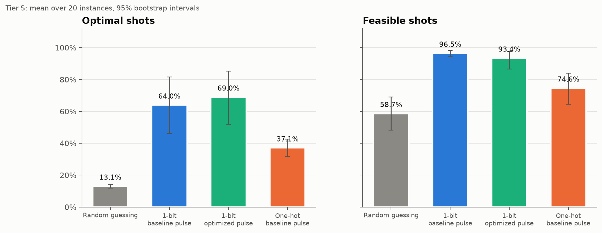
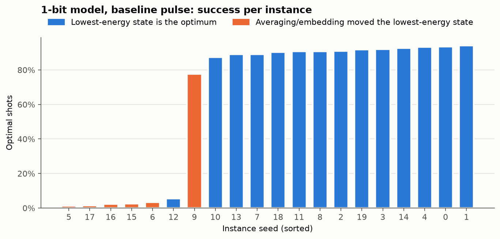
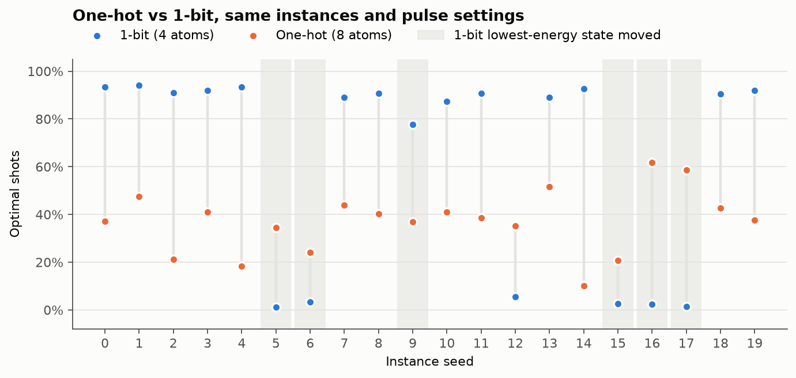

# Capacitated Vehicle Routing Quantum Clustering Optimization Using Unbalanced Penalization

### Team: Psychics
#### Challenge: Pasqal Neutral Atom Optimization — Track A (capacity-feasible clustering)
*DuQuantum 2026*

We assign the customers of a Capacitated Vehicle Routing Problem (CVRP) to vehicles on an emulated neutral-atom register. Each Tier S customer is one atom: `z_i = 1` puts customer `i` in vehicle 1 and `z_i = 0` in vehicle 2. Capacity is handled without slack variables, using unbalanced penalization ([Montañez-Barrera et al., arXiv:2211.13914](https://arxiv.org/abs/2211.13914)). With two vehicles, that penalty reduces to a load-balancing term, so the full Tier S model needs only **4 atoms**. The slack-variable version needs 14.

## Report

**[Read the report (PDF)](Capacitated%20Vehicle%20Routing%20Quantum%20Clustering%20Optimization%20Using%20Analog%20Neutral%20Atoms%20with%20Compact%20Slack-Free%20Encoding.pdf)**: *Capacitated Vehicle Routing Quantum Clustering Optimization Using Analog Neutral Atoms with Compact Slack-Free Encoding* (A. C. Khanna, Y. Ashour, I. Atteson). This is the 4-page write-up requested by the Pasqal challenge brief:

1. **Overview**: the CVRP, cluster-first / route-second, and why atom count and global detuning constrain the encoding.
2. **Tier S model**: the formal problem, the slack-free capacity penalty derived from unbalanced penalization, the QUBO coefficients, and the variable-count comparison (4 atoms vs 8 one-hot vs 14 with slack).
3. **Quantum implementation**: the Rydberg Hamiltonian mapping, SLSQP embedding and its error metric, the mean global detuning, and the sin² / linear-sweep pulse.
4. **Results and discussion**: emulator vs random sampling over 20 instances, variable efficiency across tiers, what went wrong (including the Tier M embedding attempt), and an AI-use disclosure.

## Challenge deliverables checklist

Where each item from the Pasqal brief (Deliverable 10.1) lives:

| # | Deliverable | Where |
|---|---|---|
| 1 | README with a one-command reproduction | [Quick start](#quick-start-reproduce-the-headline-result) |
| 1 | Pinned environment | [`requirements.txt`](requirements.txt) (exported from [`uv.lock`](uv.lock)), plus `.python-version` (Python 3.13) |
| 2 | Model write-up, derived from scratch | [Report](#report) §2–3, and [`docs/tier_s_model.md`](docs/tier_s_model.md) |
| 2 | Variable-count table (Section 4) | [Model](#model) below, and report §2.4 / §4.2 |
| 3 | Instance generator and seeds | `src/main.py --tier s generate` ([`src/duquantum/tier_s/instances.py`](src/duquantum/tier_s/instances.py)); seeds 0–19 |
| 3 | Instances with feasibility certificates | [`src/instances/tier_s/`](src/instances/tier_s/), with a `certificate` in every JSON |
| 3 | Validator | `src/main.py --tier s validate src/instances/tier_s/*.json` |
| 3 | Reference values | `clustering_reference_cost` and `cvrp_reference_cost` columns in each `results.csv`, all `proven_optimum` (brute force) |
| 4 | `results.csv`, one row per (instance, method, seed), with the Section 9 metrics | [`src/results/tier_s/submission_01/results.csv`](src/results/tier_s/submission_01/results.csv); columns in [`docs/tier_s_metrics.md`](docs/tier_s_metrics.md) |
| 5 | Report (≤ 4 pages) with a “what did not work” section | [Report PDF](#report), 4 pages, §4.3 “What Went Wrong” |

**Reference method.** All Tier S references are proven optima from exhaustive enumeration: 16 assignments for clustering, and every feasible assignment with every route order for the CVRP. We did not run CPLEX as a second check; brute force is exact at this size.

## Quick start: reproduce the headline result

From the repository root:

```bash
uv sync --locked
uv run python src/main.py --tier s benchmark \
  --instances-dir src/instances/tier_s \
  --output-dir src/results/tier_s/reproduce \
  --no-optimize-pulses --backend emu-sv --shots 1000 --dt 10 --epsilon 0
```

This evaluates all 20 certified Tier S instances with four methods: exact clustering, exact QUBO, uniform random sampling and emu-sv emulation. It takes about 30 seconds on a laptop CPU. The output folder must be absent or empty, so pick a new name for each run; the committed folders listed under [Results files](#results-files) will be refused. Results go to `results.csv` (one row per instance and method), `summary.json`, `manifest.json` (settings and hashes), and one detail JSON per instance.

To include pulse optimization (10 search evaluations per instance, slower):

```bash
uv run python src/main.py --tier s benchmark \
  --instances-dir src/instances/tier_s \
  --output-dir src/results/tier_s/reproduce_optimized \
  --optimize-pulses --evaluations 10 --dt 1
```

## Headline results (Tier S, 20 instances, 1000 shots each)

| Method | Atoms | Feasible shots | Optimal shots | Best model gap |
|---|---|---|---|---|
| Uniform random bitstrings | – | 58.7% | 13.1% | 0% |
| emu-sv, baseline pulse | 4 | 96.5% | 64.0% | 0% on all 20 |
| emu-sv, optimized pulse | 4 | 93.4% | 69.0% | 0% on all 20 |

Values are means over instances. "Optimal shots" is the fraction of all shots that equal the exact constrained clustering optimum. The baseline row is the quick-start command; its submitted output is `src/results/tier_s/submission_01/`. The optimized row is `src/results/tier_s/optimized_10/`.

### Results files

Each folder holds `results.csv` (one row per instance × method, with every metric from the challenge brief), `summary.json` (aggregates), `manifest.json` (settings, package versions and file hashes) and one detail JSON per instance. Column definitions are in [docs/tier_s_metrics.md](docs/tier_s_metrics.md).

| Folder | What it is |
|---|---|
| [`src/results/tier_s/submission_01/`](src/results/tier_s/submission_01/results.csv) | **Submitted results:** baseline pulse, emu-sv, 20 instances (the headline row) |
| [`src/results/tier_s/reproduce/`](src/results/tier_s/reproduce/results.csv) | A re-run of the quick-start command, confirming the submission reproduces |
| [`src/results/tier_s/baseline/`](src/results/tier_s/baseline/results.csv) | Baseline pulse at a 1 ns integration step (same per-instance results) |
| [`src/results/tier_s/optimized_10/`](src/results/tier_s/optimized_10/results.csv) | Pulse-optimized run, 10 search evaluations per instance |

### Summarizing and visualizing results

Two helper scripts read a `results.csv`:

- **[`visualize_results.py`](visualize_results.py)** draws five charts and a click-through viewer: quantum vs random, optimal probability by seed, ground-state preservation, embedding error vs success, and CVRP gap by seed. The committed output is in [`demo_charts/`](demo_charts/); open `demo_charts/index.html` and use the arrow keys.
  ```bash
  uv run python visualize_results.py src/results/tier_s/submission_01/results.csv --output demo_charts
  ```
- **[`analysis/grok_summary.py`](analysis/grok_summary.py)** prints the mean, median, minimum and maximum of the optimal-shot and feasibility rates, plus how many instances keep the true optimum as the lowest-energy state (generated with Grok, reviewed by the team).
  ```bash
  uv run python analysis/grok_summary.py
  ```

**Known limitation.** The register uses one global detuning, but this QUBO's linear coefficients differ per customer. We set the detuning to their mean. On 8 of 20 instances, this averaging alone moves the register's lowest-energy state away from the true optimum. After embedding, 6 instances still have the wrong lowest-energy state, and on 5 of those the optimal-shot rate falls below 4%. This is recorded per instance in the `global_all_ground_states_original_optimal` and `embedded_all_ground_states_original_optimal` columns of `results.csv`.

**CVRP gap.** The quick-start run also routes each sampled feasible clustering exactly (classically) and compares it with the exact CVRP optimum (`best_cvrp_gap_pct`). Because cluster-first / route-second is a heuristic, the clustering optimum is not always the best clustering for routing. The mean best CVRP gap is 5.5% for emu-sv. Uniform random reaches 0% only because 1000 shots cover all 16 possible 4-bit assignments.

## Statistical analysis

Intervals are 95% percentile-bootstrap intervals over the 20 instances. Paired tests are two-sided Wilcoxon signed-rank tests on the same instances.



| Method | Atoms | Optimal shots, mean [95% CI] | Median | Feasible shots, mean [95% CI] |
|---|---|---|---|---|
| Random guessing | – | 13.1% [12.0, 14.2] | 13.8% | 58.7% [48.3, 69.0] |
| 1-bit, baseline pulse | 4 | 64.0% [46.1, 81.5] | 89.8% | 96.5% [94.5, 98.2] |
| 1-bit, optimized pulse | 4 | 69.0% [52.0, 85.1] | 93.5% | 93.4% [86.5, 97.7] |
| One-hot, baseline pulse | 8 | 37.1% [31.5, 42.6] | 38.0% | 74.6% [64.4, 83.9] |

- **The emulator does useful work:** the baseline pulse beats random guessing by 50.9 percentage points on average (p < 0.001).
- **Pulse optimization helps consistently:** it improves the optimal-shot rate on all 20 instances, by 5.0 points on average (p < 0.001).
- **The results are bimodal, and the averaged detuning explains why.** On the 14 instances where the embedded register's lowest-energy state is still the optimum, the mean is 85.1%. On the other 6 (seeds 5, 6, 9, 15, 16, 17) it is 14.7%, with a median of 2.5% (Mann–Whitney p < 0.001). Embedding error, load ratio and largest-demand ratio show no significant correlation with success (all Spearman |ρ| ≤ 0.23, p ≥ 0.3).



### Trade-off: one-hot comparison (branch `one-hot-model`)

We also built a one-hot version: one atom per (customer, vehicle), 8 atoms. It has the same objective, λ, instances and pulse settings, and its linear terms are uniform, so one global detuning reproduces it **exactly**. It is lower on average (37.1% vs 64.0%, p = 0.02) but never collapses (minimum 10.1%). On the 6 instances where the 1-bit model broke, one-hot averages 39.4% against 14.7%.

We submit the 4-atom model and accept its averaged detuning: it halves the atom count and wins on 14 of 20 instances. The one-hot branch documents the alternative and is not merged.



The full analysis (script, `stats.md`, three more figures) is on branch `graphs-and-statistical-analysis`. It is also not merged.

## Model

Full derivations, with equations:

- [docs/tier_s_model.md](docs/tier_s_model.md): Tier S model (N=4, K=2, Q=7), QUBO, Ising mapping, global detuning, pulse functions
- [docs/tier_s_metrics.md](docs/tier_s_metrics.md): every `results.csv` column and how it maps to the challenge metrics
- [docs/tier_m_model.md](docs/tier_m_model.md): Tier M model (N=10, K=3, 2 bits per customer, 20 atoms). This is a derivation only; it is not implemented in code yet.

In short, the cost is

```math
F(z)=\sum_{i<j}D_{ij}(1-z_i-z_j+2z_iz_j)+2\lambda\left(\sum_i d_i z_i-\frac{T}{2}\right)^2,\qquad \lambda=0.1
```

The first term is the total distance between customers who share a vehicle. The second favors balanced loads; the capacity `Q` cancels out of it. Every measured bitstring is therefore checked against the original capacity constraints, and only feasible shots count toward gaps.

Variable-count table (challenge brief, Derive 4.1):

| Encoding | Variable count | S | M | L | Fits in 80 atoms? |
|---|---|---|---|---|---|
| Assignment variables only (one-hot) | NK | 8 | 30 | 60 | Yes |
| + binary-encoded slack | NK + K⌈log₂(Q+1)⌉ | 14 | 45 | 80 | Exactly at the limit |
| **This model** | N⌈log₂K⌉ | **4** | **20** | **30\*** | Yes |

\*Tier L is a projected count; only Tier S is implemented and benchmarked. A 20-atom Tier M attempt did not embed well (see the report, section 4.3).

## Pipeline

```
certified instance → QUBO (model.py) → Ising + global detuning (ising.py)
  → atom positions (embedding.py) → pulse (pulses.py) → emu-sv (emulator.py)
  → feasibility, gaps, exact routing (evaluation.py, benchmark.py)
```

- **Embedding:** atom positions are fitted numerically (multi-start SLSQP) to the target couplings. The fit respects AnalogDevice's 5 µm minimum spacing and 38 µm radius. The error is reported as `relative_interaction_error`.
- **Pulse:** a sin² Rabi envelope with a linear detuning sweep over 4 µs, using one global channel and no DMM. The optional optimizer tunes amplitude, detuning endpoints, sweep shape and duration.
- **Emulation:** ideal, noiseless emu-sv. The `--dt` flag sets the integration step in ns.

## Commands

Run from the repository root as `uv run python src/main.py --tier s <command>`. Every command supports `--help`.

| Command | Purpose |
|---|---|
| `generate --seed 0 --count 20 --output-dir src/instances/tier_s` | Create reproducible, certified instances |
| `validate src/instances/tier_s/*.json` | Check each instance's feasibility certificate |
| `classical` | Exact enumeration of the QUBO and the constrained problem |
| `run --instance src/instances/tier_s/tier_s_seed_0000.json` | Embed, optionally optimize, and emulate one instance |
| `optimize --instance ...` | Compare the baseline and optimized pulses on one instance |
| `evaluate run.json` | Re-score saved counts or a saved run |
| `benchmark ...` | Every method on every instance → `results.csv` (see Quick start) |

## Instances

`src/instances/tier_s/` holds 20 instances, seeds 0–19 (Tier S: N=4, K=2, Q=7, demands in {1,…,4}). Each file records:

- the seed and generator settings
- coordinates in a 100×100 square
- the depot, fixed at (0, 0)
- a feasibility certificate (one valid assignment and its loads)
- the load ratio ρ and the largest-demand ratio d_max/Q

Feasibility is guaranteed by drawing demands uniformly and rejecting any draw without a valid assignment. Every assignment is enumerated, and one valid assignment is stored as the certificate. Reference values are proven optima by brute force, for both the clustering and the exactly routed CVRP.

## Repository layout

```
docs/                      model derivations and metric definitions
src/main.py                command-line entry point
src/duquantum/quantum/     Ising mapping, embedding, pulses, emulator, pulse optimization
src/duquantum/tier_s/      Tier S model, instances, classical references, evaluation, benchmark
src/instances/tier_s/      the 20 certified instances
src/results/tier_s/        committed benchmark outputs (submission_01, reproduce, baseline, optimized_10)
visualize_results.py       charts from a results.csv; output in demo_charts/
analysis/grok_summary.py   short text summary of the baseline results
*.pdf (repository root)    the report
requirements.txt           pinned dependencies (pip alternative to uv.lock)
```

## Requirements

- **Python:** 3.13 or later (pinned in `.python-version`)
- **Package manager:** [uv](https://docs.astral.sh/uv/)
- **IDE:** [Visual Studio Code](https://code.visualstudio.com/) (optional)

Exact resolved versions of every package are pinned in `uv.lock`. The same pins are exported to `requirements.txt` for pip users (`python3.13 -m venv .venv && .venv/bin/pip install -r requirements.txt`). Regenerate it after changing dependencies with `uv export --format requirements-txt --no-hashes --no-emit-project --no-dev --locked -o requirements.txt`.

| Package | Version |
|---|---|
| [Pulser](https://pypi.org/project/pulser/) | ≥ 1.9.1 |
| [QoolQit](https://pypi.org/project/qoolqit/) | ≥ 1.4.0 |
| [QUBO Solver](https://pypi.org/project/qubo-solver/) | ≥ 0.9.1 |
| [Emu-SV](https://pypi.org/project/emu-sv/) | latest compatible |
| [Pasqal Cloud](https://pypi.org/project/pasqal-cloud/) | ≥ 0.24.0 |
| [NumPy](https://pypi.org/project/numpy/) | ≥ 2.5.4 |
| [SciPy](https://pypi.org/project/scipy/) | installed with Pulser; used by the embedding |
| [Matplotlib](https://pypi.org/project/matplotlib/) | ≥ 3.11.2 |
| [Dotenv](https://pypi.org/project/python-dotenv/) | ≥ 0.9.9 |
| [QuTiP](https://pypi.org/project/qutip/) | ≥ 5.3.1 |

**Development dependency:** [Ruff](https://docs.astral.sh/ruff/), for linting and formatting.

## Setup

### 1. Install uv

**macOS / Linux**
```bash
curl -LsSf https://astral.sh/uv/install.sh | sh
```

**Windows (PowerShell)**
```powershell
irm https://astral.sh/uv/install.ps1 | iex
```

### 2. Install dependencies

```bash
uv sync --locked
```

This installs the required Python version if necessary, creates `.venv`, and installs the locked dependencies, including the development dependencies.

### 3. VS Code (optional)

Open the repository and accept the recommended extensions (Python, Ruff, Jupyter) from `.vscode/extensions.json`. Then run `Python: Select Interpreter` from the Command Palette and choose `.venv/bin/python` (macOS/Linux) or `.venv\Scripts\python.exe` (Windows). `.vscode/settings.json` already sets Ruff as the formatter and formats on save.

## Managing dependencies

```bash
uv add <package>          # add a dependency
uv remove <package>       # remove a dependency
uv add --dev <package>    # add a development dependency
git pull && uv sync --locked   # sync with the shared environment
```

When changing dependencies, commit both `pyproject.toml` and `uv.lock`.

## Formatting and linting

```bash
uv run ruff check .        # check
uv run ruff check --fix .  # fix what can be fixed automatically
uv run ruff format .       # format
```
